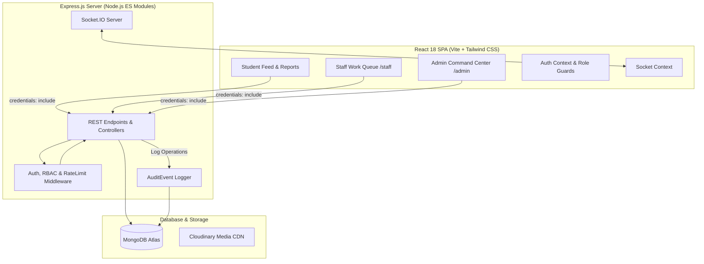

# CampusPulse 2.0 🏛️⚡

> **A real-time campus issue-reporting, operational awareness, department routing, and facilities dispatch platform for colleges and universities.**

Built with the **MERN** stack (MongoDB Atlas, Express.js, React 18 / Vite, Node.js) and powered by **Socket.IO** for live multi-user synchronization.

---

## 🌟 Key Features (CampusPulse 2.0)

### 1. Three Distinct Role-Based Operational Experiences (RBAC)
- 🎓 **Student Mode (`student`):** Submit campus issue reports with title, description, category, severity, zone, and optional photo. Support issues via "Affects Me Too", participate in public discussion threads, track personal report lifecycles, verify resolutions, and reopen unresolved issues with mandatory justifications.
- 🔧 **Department Staff Mode (`staff`):** Dedicated work-queue interface (`/staff`) displaying tickets routed to their affiliated department (`dept:<deptId>`) or assigned directly to them. Staff can filter by assigned tickets, in-progress, awaiting student info, and overdue SLAs, post internal triage notes invisible to students, and submit official resolution notes.
- 🛡️ **Administrator Command Center (`admin`):** Full situational awareness with interactive click-to-filter KPI cards, 7-day velocity series, campus zone recurrence hotspot detection, department workload distribution, SLA deadline management, departmental assignment & redirection with full history tracking, staff account provisioning, and an immutable security audit trail.

### 2. Department Management & Auto-Classification
- **11 Default Operational Units:** Automatically seeded on startup (IT Services, Electrical & Power, Plumbing & Water, Civil Infrastructure, Housekeeping & Sanitation, Campus Safety, Hostel Administration, Sports & Athletics, Library & Learning Spaces, Cafeteria & Dining, Academic Block Facilities).
- **Administrative Roster (`/admin?view=departments`):** Create new operational departments with custom routing codes (e.g. `ROBOTICS`, `ELEC`), toggle active receiving state, and monitor live ticket workloads.
- **Auto-Suggested Routing:** Students can designate a suggested department upon filing, or let the platform route based on category rules.

### 3. Real Staff Assignment, Redirection & Assignment History
- **Two-Tier Assignment:** Issues can be routed to a target department and assigned to a specific specialist within that department.
- **Incompatible Staff Cleanup:** When redirecting an issue from Department A to Department B, the previous assignee is automatically unassigned or reassigned to preserve operational integrity.
- **Assignment History Audit:** Full chronological log stored directly on each `Issue` (`assignmentHistory`) recording `previousDepartment`, `newDepartment`, `previousAssignee`, `newAssignee`, `changedBy`, `reason`, `action`, and `timestamp`.

### 4. Three-Tier Visibility & Confidentiality Enforcement
- 🌐 **Public (`public`):** Broadcast to the campus feed, visible to all authenticated students, staff, and administrators.
- 🏢 **Department Only (`department_only`):** Visible exclusively to the reporting student, administrators, and assigned department staff. Omitted from general campus feeds.
- 🔒 **Confidential (`confidential`):** Strict privacy boundary for sensitive complaints (e.g. safety, harassment, interpersonal hostel disputes). Visible **only** to the reporting student, administrators, and the explicitly assigned staff specialist. Unrelated students and non-assigned staff receive an HTTP 404 Not Found. Excluded from Duplicate Radar to prevent privacy leaks.

### 5. Public Updates vs. Internal Staff Notes
- **Threaded Communication:** Standard discussion comments are visible to the student and campus community.
- **Internal Staff Notes (`isInternal: true`):** Highlighted with amber triage styling, internal notes allow administrators and technicians to discuss part ordering, contractor dispatch, and sensitive diagnostics.
- **Security Guarded:** Students attempting to post internal notes receive HTTP 403 Forbidden. Backend comment queries automatically filter out internal notes for non-staff/non-admin users.

### 6. SLA Deadlines, Urgency Tiers & Overdue Tracking
- **Standardized Priorities:** `low`, `normal`, `high`, `critical`.
- **Target Deadlines:** Track both initial response deadline and target resolution deadline.
- **Dynamic Overdue Tracking:** Real-time computation of `isOverdue` for unresolved tickets past their SLA target date, with dedicated KPI filters on admin and staff queues.

### 7. Resolution Verification & Student Dispute/Reopen Workflow
- **Staff/Admin Resolution:** Official resolution notes explain repairs, parts replaced, and contractor clearance.
- **Student Verification & Reopen:** The reporting student or an administrator can reopen a resolved ticket via `POST /api/issues/:id/reopen` with a mandatory reason (minimum 10 characters). Reopened issues automatically transition to `in_progress` and increment `reopenCount`.

### 8. Immutable System Audit Trail (`AuditEvent`)
- Tamper-evident logging for all significant operational decisions: `issue_created`, `issue_assigned`, `issue_redirected`, `issue_unassigned`, `priority_deadlines_updated`, `visibility_updated`, `department_created`, `staff_account_created`, `staff_account_updated`.
- Accessible via `/admin?view=audit` with actor information, entity links, operation timestamps, and context diffs.

---

## 📐 System Architecture



---

## 🛠️ Tech Stack

| Layer | Technologies |
|---|---|
| **Frontend** | React 18, Vite, JavaScript (ES Modules), React Router v6, Tailwind CSS, Lucide React icons |
| **Backend** | Node.js (v20+), Express.js 4 (ES Modules), MVC architecture, Socket.IO 4 |
| **Database** | MongoDB Atlas with Mongoose ODM (text search indexes, compound unique indexes, TTL) |
| **Storage** | Cloudinary SDK with Multer (in-memory streaming) |
| **Authentication** | JSON Web Tokens (JWT) stored in HttpOnly cookies, bcryptjs password hashing |
| **Security** | `express-rate-limit`, CORS origin whitelist, binary magic-byte validation, HttpOnly SameSite cookies |
| **Testing** | Comprehensive automated test suite with 99 test assertions (`npm test`) |

---

## 📁 Repository Structure

```text
campuspulse/
├── package.json                      # Root workspace scripts (dev, build, test, seed:admin)
├── render.yaml                       # Render Web Service Blueprint specification
├── README.md                         # Project documentation and architecture guide
│
├── docs/
│   └── DEMO.md                       # Comprehensive live viva examination demonstration script
│
├── server/                           # Express.js REST API & Socket.IO server
│   ├── package.json                  # Server dependencies ("type": "module")
│   ├── .env.example                  # Environment variable configuration template
│   └── src/
│       ├── server.js                 # HTTP & Socket.IO server bootstrap with DB & default depts
│       ├── app.js                    # Express configuration, CORS, cookies, SPA fallback
│       ├── config/
│       │   ├── index.js              # Centralized environment variable loader
│       │   └── db.js                 # Resilient Mongoose connection with lifecycle hooks
│       ├── controllers/              # MVC Route Controllers
│       │   ├── authController.js     # Register, Login, Logout, Me, AdminCheck
│       │   ├── issueController.js    # Issue CRUD, confidential privacy checks, reopen
│       │   ├── departmentController.js# Department roster, active toggles, staff list
│       │   ├── staffController.js    # Staff work queue, personal stats, triage updates
│       │   ├── adminController.js    # Queue, assignments, redirections, SLAs, staff accounts, audit
│       │   ├── commentController.js  # Threaded comments & internal staff notes
│       │   ├── notificationController.js # Targeted notifications & unread tracking
│       │   └── healthController.js   # Health check with sanitized DB status
│       ├── middleware/
│       │   ├── auth.js               # authenticate, authenticateOptional, requireAdmin, requireStaff
│       │   ├── rateLimiter.js        # express-rate-limit protection
│       │   ├── upload.js             # Multer & binary magic byte validation
│       │   └── errorHandler.js       # Central error handling middleware
│       ├── models/                   # Mongoose Data Models
│       │   ├── User.js               # Student, Admin & Staff user schema
│       │   ├── Department.js         # Campus operational departments & seed list
│       │   ├── Issue.js              # Campus issue schema with assignment & status history
│       │   ├── Comment.js            # Comments model with visibility & isInternal flags
│       │   ├── AuditEvent.js         # Immutable security & operations audit trail
│       │   ├── Notification.js       # In-app notifications model
│       │   └── IssueConfirmation.js  # "Affects Me Too" compound index model
│       └── scripts/
│           ├── seedAdmin.js          # CLI script to provision administrator account
│           └── testSuite.js          # Complete automated test suite (99 test assertions)
│
└── client/                           # React 18 + Vite frontend
    ├── package.json                  # Client dependencies & scripts
    ├── vite.config.js                # Vite config with /api & /socket.io dev proxies
    └── src/
        ├── App.jsx                   # Application routes with Student, Staff, and Admin layout guards
        ├── context/
        │   ├── AuthContext.jsx       # User state with isStaff, isStudent, isAdmin flags
        │   └── SocketContext.jsx     # Authenticated Socket.IO client provider
        ├── services/
        │   └── api.js                # Universal fetch API client with credentials
        ├── components/
        │   ├── auth/                 # ProtectedRoute, StaffRouteGuard, AdminRouteGuard
        │   ├── layout/               # Header, Sidebar, StaffLayout, AdminLayout
        │   └── issues/               # IssueCard, StatusHistoryTimeline, InternalNoteThread
        └── pages/
            ├── FeedPage.jsx          # Live campus issue feed with search & filters
            ├── NewIssuePage.jsx      # Issue submission with visibility & department routing
            ├── IssueDetailsPage.jsx  # Discussion thread, internal notes & student reopen
            ├── StaffDashboardPage.jsx# Department staff work queue & triage actions
            ├── AdminDashboardPage.jsx# Command center, departments, staff roster, audit trail
            └── AdminIssueDetailsPage.jsx # Assignment, redirection, SLA & visibility modal
```

---

## ⚡ Quick Start & Verification

### 1. Prerequisites
- Node.js v18 or v20+
- MongoDB Atlas database connection URI
- (Optional) Cloudinary account for media attachments

### 2. Installation
```bash
# Clone the repository
git clone <repo-url> campuspulse
cd campuspulse

# Install root, backend, and frontend dependencies
npm install
npm --prefix server install
npm --prefix client install
```

### 3. Configuration
Create `server/.env` based on `server/.env.example`:
```ini
PORT=5000
NODE_ENV=development
CLIENT_ORIGIN=http://localhost:5173
MONGODB_URI=mongodb+srv://<username>:<password>@cluster.mongodb.net/campuspulse?retryWrites=true&w=majority
JWT_SECRET=super_secret_jwt_key_at_least_32_chars_long
JWT_EXPIRES_IN=7d
COOKIE_NAME=token
# Optional Cloudinary credentials
CLOUDINARY_CLOUD_NAME=your_cloud_name
CLOUDINARY_API_KEY=your_api_key
CLOUDINARY_API_SECRET=your_api_secret
```

### 4. Run the Full Test Suite
```bash
npm test
```
Executes all **99 automated test cases** verifying health checks, authentication, RBAC, Socket.IO live sync, department routing, staff queues, confidentiality, assignments, internal notes, SLAs, reopen workflow, and audit logs.

### 5. Start Development Servers
```bash
npm run dev
```
- Express API & Sockets: `http://localhost:5000`
- React Frontend: `http://localhost:5173`

---

## 🎓 University Viva & Demonstration Guide

Refer to [`docs/DEMO.md`](docs/DEMO.md) for a structured 3–5 minute step-by-step viva presentation script featuring multi-window demonstration of:
1. Role boundary isolation (Student, Staff, and Administrator).
2. Confidential report filing and strict 404 security checks for unrelated users.
3. Department assignment, technician routing, and redirection with history tracking.
4. Internal staff notes vs. public discussion comments.
5. SLA targets, overdue detection, resolution notes, and the student reopen workflow.
6. System audit trail logging every administrative operation.
