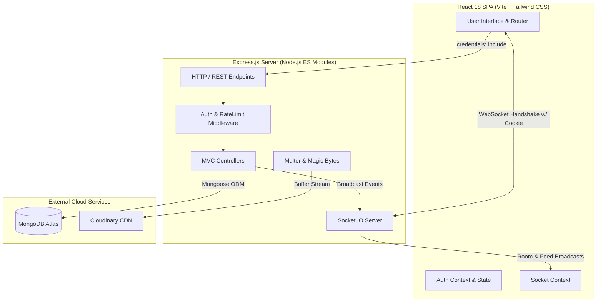

# CampusPulse 2.0 🏛️⚡

> **A real-time campus issue-reporting, operational awareness, and facilities dispatch platform for colleges and universities.**

Built with the **MERN** stack (MongoDB Atlas, Express.js, React 18 / Vite, Node.js) and powered by **Socket.IO** for live multi-user synchronization.

---

## 🌟 Key Features (CampusPulse 2.0)

- 🎛️ **Campus Command Center:** Executive administrative operational dashboard featuring:
  - **Interactive Click-to-Filter KPI Cards:** One-click filtering of the operational review queue by Pending Review, In Progress, Resolved, Critical Hazards, and Active Advisories.
  - **7-Day Inflow Velocity Trend:** Daily incident velocity bar chart tracking report volume over time.
  - **Category Clustering:** Real-time proportional distribution across infrastructure, electrical, plumbing, sanitation, safety, and IT.
  - **Status Lifecycle Split:** High-level operational overview of ticket progress.
- 📍 **Campus Hotspots & Recurrence Detection:** Standardized campus zones (`CAMPUS_ZONES`: Academic Blocks, Library, Hostels, Cafeteria, Sports Complex, Admin Block, Labs & Research, Parking & Transit, Auditorium, Campus Grounds, Other). Automatically computes a recurrence score based on active volume, critical hazards, and recent recurrence (14-day rolling window) with a 1-click **Drill Down** filter.
- 📡 **Duplicate Radar (Pre-Submission Similarity Detection):** Lightweight client-server similarity engine that detects existing unresolved reports as students type their title or select categories/locations. Displays non-blocking match cards with a "View & Support This Instead" button to prevent redundant tickets.
- 📜 **Complete Issue Lifecycle & Chronological Audit Trail:** Persistent `statusHistory` array on the `Issue` model capturing every state change (`reported` → `verified` → `in_progress` → `resolved`, or `rejected`), recording the responsible actor, timestamp, and official administrative resolution notes.
- 📢 **Structured Issue Reporting:** Students submit campus issues with title, description, category, severity levels (low, moderate, high, critical), standardized campus zones, and room details.
- 📸 **Cloudinary Photo Uploads:** Optional real-time issue photo attachments with memory buffer streaming, file size guards (5MB), and binary magic-byte verification (JPEG/PNG/WebP). Text-only reporting remains fully functional if Cloudinary is unconfigured.
- 🛡️ **Role-Based Access Control (RBAC):** Strict separation between student and administrator modes. Students cannot approve alerts, verify their own reports, or arbitrarily resolve issues; administrators are restricted to management workflows.
- 🚨 **Campus-Wide Alert Lifecycles:** Urgent hazards can request emergency visibility. Only verified administrators can approve campus-wide alerts, immediately fanning out notifications and pinning red warning banners across campus feeds.
- ⚡ **Authenticated Real-Time Synchronization (Socket.IO):** Live feed updates, comment feeds, notification delivery, and admin review queue counters sync instantaneously via WebSocket connections authenticated through HttpOnly JWT cookies.
- 💬 **Persistent Discussion Threads:** Students and staff collaborate inside dedicated issue rooms (`issue:<id>`). Comments persist to MongoDB and broadcast in real-time.
- 👥 **Community Signal System ("Affects Me Too"):** Unique affirmation support with compound index enforcement (`{ issue: 1, user: 1 }`), live counter broadcasts, and optimistic UI.
- 🔔 **Targeted In-App Notifications:** Event-driven notification system storing updates in MongoDB and pushing live updates to private user rooms (`user:<userId>`).
- 🔒 **Production Security Hardened:** HttpOnly `SameSite=Lax` cookies prevent XSS token theft, bcryptjs hashes passwords (12 salt rounds), express-rate-limit configured with trust proxy guards against `ERR_ERL_UNEXPECTED_X_FORWARDED_FOR`, and strict input validation guards all endpoints.

---

## 📐 System Architecture



---

## 🛠️ Tech Stack

| Layer | Technologies |
|---|---|
| **Frontend** | React 18, Vite, JavaScript (ES Modules), React Router v6, Tailwind CSS, Lucide React icons |
| **Backend** | Node.js (v20+), Express.js 4 (ES Modules), MVC architecture, Socket.IO 4 |
| **Database** | MongoDB Atlas with Mongoose ODM (text search indexes, compound unique indexes) |
| **Storage** | Cloudinary SDK with Multer (in-memory streaming) |
| **Authentication** | JSON Web Tokens (JWT) stored in HttpOnly cookies, bcryptjs password hashing |
| **Security** | `express-rate-limit`, CORS with origin whitelist and credentials, binary magic-byte validation |
| **Deployment** | Single-origin static SPA serving, Render Web Service (`render.yaml`) |

---

## 📁 Repository Structure

```text
campuspulse/
├── package.json                      # Root workspace scripts (dev, build, test, seed:admin)
├── render.yaml                       # Render Web Service Blueprint specification
├── .gitignore                        # Git exclusion rules (node_modules, dist, .env)
├── README.md                         # Project documentation and architecture guide
│
├── docs/
│   └── DEMO.md                       # 3-5 minute live viva examination demonstration script
│
├── server/                           # Express.js REST API & Socket.IO server
│   ├── package.json                  # Server dependencies ("type": "module")
│   ├── .env.example                  # Environment variable configuration template
│   └── src/
│       ├── server.js                 # HTTP & Socket.IO server bootstrap with DB connection
│       ├── app.js                    # Express configuration, CORS, cookies, SPA fallback
│       ├── config/
│       │   ├── index.js              # Centralized environment variable loader
│       │   └── db.js                 # Resilient Mongoose connection with lifecycle hooks
│       ├── controllers/              # MVC Route Controllers
│       │   ├── authController.js     # Register, Login, Logout, Me, AdminCheck
│       │   ├── issueController.js    # Issue CRUD, alerts, search, affirmations
│       │   ├── commentController.js  # Persistent threaded comments
│       │   ├── adminController.js    # Review queue, alert approvals, transitions, stats
│       │   ├── notificationController.js # Notifications querying & mark-as-read
│       │   └── healthController.js   # Health check with sanitized DB status
│       ├── middleware/
│       │   ├── auth.js               # authenticate & requireAdmin guards
│       │   ├── rateLimiter.js        # express-rate-limit protection
│       │   ├── upload.js             # Multer & binary magic byte validation
│       │   ├── notFound.js           # Standardized JSON 404 handler
│       │   └── errorHandler.js       # Central error handling middleware
│       ├── models/                   # Mongoose Data Models
│       │   ├── User.js               # Student & Admin user schema with bcrypt
│       │   ├── Issue.js              # Campus issue schema with full lifecycle
│       │   ├── IssueConfirmation.js  # Compound index social affirmation model
│       │   ├── Comment.js            # Threaded comments model
│       │   └── Notification.js       # In-app notifications model
│       ├── routes/                   # API Route definitions
│       │   ├── index.js              # Central API router (/api/...)
│       │   ├── authRoutes.js         # /api/auth
│       │   ├── issueRoutes.js        # /api/issues
│       │   ├── commentRoutes.js      # /api/comments
│       │   ├── adminRoutes.js        # /api/admin
│       │   ├── notificationRoutes.js # /api/notifications
│       │   └── healthRoutes.js       # /api/health
│       ├── utils/
│       │   ├── socket.js             # Authenticated Socket.IO manager & event emitters
│       │   ├── token.js              # JWT generation & cookie setters
│       │   ├── cloudinary.js         # Cloudinary buffer upload & delete helpers
│       │   ├── categoryHelper.js     # Category normalization helper
│       │   └── notificationHelper.js # Safe notification generation & alert fan-out
│       └── scripts/
│           ├── seedAdmin.js          # CLI script to provision administrator account
│           └── testSuite.js          # Complete automated test suite (40 test assertions)
│
└── client/                           # React 18 + Vite frontend
    ├── package.json                  # Client dependencies & scripts
    ├── vite.config.js                # Vite config with /api & /socket.io dev proxies
    ├── tailwind.config.js            # Tailwind configuration
    ├── index.html                    # Single Page Application entrypoint
    └── src/
        ├── main.jsx                  # React DOM mount with BrowserRouter
        ├── App.jsx                   # Application routes, AuthProvider, SocketProvider
        ├── context/
        │   ├── AuthContext.jsx       # User authentication state
        │   └── SocketContext.jsx     # Authenticated Socket.IO client provider
        ├── services/
        │   └── api.js                # Universal fetch API client with credentials
        ├── components/
        │   ├── common/               # Badges, loaders, EmptyState
        │   ├── layout/               # Header, Sidebar, AppLayout with live toast
        │   ├── issues/               # IssueCard, AlertBanner, FeedFilters
        │   └── auth/                 # ProtectedRoute & PublicOnlyRoute
        └── pages/
            ├── FeedPage.jsx          # Live campus issue feed with search & filters
            ├── LoginPage.jsx         # Persistent student/admin authentication
            ├── RegisterPage.jsx      # Student registration
            ├── NewIssuePage.jsx      # Multi-part issue submission with photo
            ├── IssueDetailsPage.jsx  # Live discussion thread & "Affects Me Too"
            ├── MyReportsPage.jsx     # Student's submitted reports management
            ├── NotificationsPage.jsx # Database-backed notification center
            ├── AdminDashboardPage.jsx# Live admin review queue and statistics
            └── NotFoundPage.jsx      # Client 404 view
```

---

## ⚡ Quickstart & Local Setup

### 1. Prerequisites
- **Node.js** v20.x or higher
- **npm** v10.x or higher
- A free **MongoDB Atlas** cluster URI

### 2. Clone & Install Dependencies
```bash
git clone <repo-url> campuspulse
cd campuspulse
npm run install:all
```

### 3. Configure Server Environment
Create `server/.env` based on `server/.env.example`:
```ini
NODE_ENV=development
PORT=5000
HOST=127.0.0.1
CLIENT_ORIGIN=http://localhost:5173

# MongoDB Atlas
MONGODB_URI=mongodb+srv://<username>:<password>@cluster.mongodb.net/campuspulse?retryWrites=true&w=majority

# JWT Session Secret
JWT_SECRET=super_strong_jwt_secret_key_minimum_32_characters

# Admin Seed Credentials
ADMIN_NAME="Campus Administrator"
ADMIN_EMAIL=admin@campus.edu
ADMIN_PASSWORD=change_this_admin_password_123

# Cloudinary (Optional - text reporting works without it)
CLOUDINARY_CLOUD_NAME=your_cloud_name
CLOUDINARY_API_KEY=your_api_key
CLOUDINARY_API_SECRET=your_api_secret
```

### 4. Seed Administrator Account
```bash
npm run seed:admin
```

### 5. Run Full-Stack Development
```bash
npm run dev
```
- **Backend API & Sockets:** `http://127.0.0.1:5000`
- **Frontend Application:** `http://localhost:5173`

---

## 🧪 Automated Testing Suite

CampusPulse includes a comprehensive 40-step end-to-end automated test suite verifying health checks, authentication, authorization, Socket.IO handshakes, room isolation, real-time broadcasts, and data integrity:

```bash
npm test
```

### Verified Test Areas:
1. `GET /api/health` reports status `ok` and DB `connected` without credential leakage.
2. Single-origin SPA fallback serves HTML for `/feed` and JSON 404 for `/api/*`.
3. Student registration and login correctly set HttpOnly `token` cookies.
4. Role-based authorization: Students receive `403 Forbidden` on `/api/admin/*`.
5. Socket.IO connection is rejected without cookies or with invalid tokens.
6. Authenticated Socket.IO connection joins personal `user:<id>` and `role:admin` rooms.
7. Real-time broadcast of `issue:created` upon REST report submission.
8. Discussion thread room (`join:issue`) receives real-time `comment:created` events.
9. "Affects Me Too" toggles affirmation in MongoDB and broadcasts `confirmation:updated`.
10. Admin review transition to `verified` promotes emergency alert and broadcasts `alert:approved`.
11. Author receives database-backed in-app notification in private user room.
12. Clean teardown and test record purge from MongoDB Atlas.

---

## 🚀 Production Deployment (Render)

CampusPulse is configured for single-origin deployment on **Render** (or any Node.js PaaS). Express serves the production React build from `client/dist` and handles SPA client-side routing.

### Render Blueprint Deployment (`render.yaml`):
1. Connect your GitHub repository to [Render](https://render.com).
2. Create a new **Web Service** from the repository or select Blueprint.
3. Configure environment variables in the Render dashboard:
   - `NODE_ENV`: `production`
   - `MONGODB_URI`: `<your-atlas-uri>`
   - `JWT_SECRET`: `<your-strong-secret>`
   - `ADMIN_EMAIL`: `<admin-email>`
   - `ADMIN_PASSWORD`: `<admin-password>`
   - `CLOUDINARY_CLOUD_NAME`, `CLOUDINARY_API_KEY`, `CLOUDINARY_API_SECRET` *(optional)*
4. Build Command:
   ```bash
   npm run install:all && npm run build
   ```
5. Start Command:
   ```bash
   npm start
   ```

---

## 📡 API Reference

### Authentication (`/api/auth`)
| Method | Endpoint | Description | Access |
|---|---|---|---|
| `POST` | `/api/auth/register` | Register new student account | Public |
| `POST` | `/api/auth/login` | Authenticate user & issue HttpOnly JWT | Public |
| `POST` | `/api/auth/logout` | Clear authentication cookie | Authenticated |
| `GET` | `/api/auth/me` | Fetch active user profile | Authenticated |
| `GET` | `/api/auth/admin-check` | Verify administrator authorization | Admin Only |

### Issues (`/api/issues`)
| Method | Endpoint | Description | Access |
|---|---|---|---|
| `POST` | `/api/issues` | Create new issue report (with optional image) | Authenticated |
| `GET` | `/api/issues` | Paginated campus feed with filters & search | Authenticated |
| `GET` | `/api/issues/mine` | List reports submitted by current user | Authenticated |
| `GET` | `/api/issues/alerts` | Get currently active approved campus alerts | Authenticated |
| `GET` | `/api/issues/:id` | Get issue details with affirmation status | Authenticated |
| `PATCH` | `/api/issues/:id` | Edit report (author only, 'reported' status) | Authenticated |
| `DELETE` | `/api/issues/:id` | Delete report (author or admin) | Authenticated |
| `POST` | `/api/issues/:id/confirm` | Add "Affects Me Too" confirmation | Authenticated |
| `DELETE`| `/api/issues/:id/confirm` | Remove "Affects Me Too" confirmation | Authenticated |

### Comments (`/api/issues/:id/comments`)
| Method | Endpoint | Description | Access |
|---|---|---|---|
| `GET` | `/api/issues/:id/comments` | Retrieve paginated comments for issue | Authenticated |
| `POST` | `/api/issues/:id/comments` | Post comment to discussion thread | Authenticated |
| `PATCH`| `/api/comments/:id` | Edit comment (author only) | Authenticated |
| `DELETE`| `/api/comments/:id` | Delete comment (author or admin) | Authenticated |

### Admin Operations (`/api/admin`)
| Method | Endpoint | Description | Access |
|---|---|---|---|
| `GET` | `/api/admin/issues` | Review queue with search & filters | Admin Only |
| `PATCH`| `/api/admin/issues/:id/review` | Verify / Reject report & approve alert | Admin Only |
| `PATCH`| `/api/admin/issues/:id/status` | Lifecycle update (in_progress, resolved) | Admin Only |
| `GET` | `/api/admin/stats` | Database-backed KPI metrics & breakdown | Admin Only |

### Notifications (`/api/notifications`)
| Method | Endpoint | Description | Access |
|---|---|---|---|
| `GET` | `/api/notifications` | Paginated list of user notifications | Authenticated |
| `PATCH`| `/api/notifications/:id/read` | Mark individual notification as read | Authenticated |
| `PATCH`| `/api/notifications/read-all` | Mark all notifications as read | Authenticated |

---

## 🔌 Socket.IO Events & Room Architecture

```
                  +--------------------------------+
                  |  Socket.IO Handshake / Auth    |
                  |  (Verifies HttpOnly JWT Cookie)|
                  +---------------+----------------+
                                  |
                +-----------------+-----------------+
                |                                   |
                v                                   v
    +-----------------------+           +-----------------------+
    | Room: user:<userId>   |           | Room: role:admin      |
    | (Private Notifications|           | (Admin Queue Events)  |
    +-----------------------+           +-----------------------+
                |
                v
    +-----------------------+
    | Room: issue:<issueId> |
    | (Discussion Threads)  |
    +-----------------------+
```

### Event Reference:
| Event Name | Scope / Target | Payload Data | Triggered When |
|---|---|---|---|
| `issue:created` | Broadcast | `{ issueId, issue }` | New report submitted |
| `issue:updated` | Broadcast & `issue:<id>` | `{ issueId, issue }` | Report details updated |
| `issue:deleted` | Broadcast & `issue:<id>` | `{ issueId }` | Report deleted |
| `issue:statusChanged` | Broadcast & `issue:<id>` | `{ issueId, status, issue }` | Status moved by admin |
| `alert:approved` | Broadcast | `{ issueId, alert }` | Emergency alert approved |
| `comment:created` | `issue:<id>` | `{ issueId, comment }` | Comment posted in thread |
| `comment:deleted` | `issue:<id>` | `{ issueId, commentId }` | Comment removed |
| `confirmation:updated` | Broadcast & `issue:<id>` | `{ issueId, confirmationCount }` | Affects Me Too toggled |
| `notification:new` | `user:<userId>` | `{ notification }` | Status change or alert |

---

## 🎓 Viva & End-Term Evaluation

For a step-by-step 3-5 minute live presentation script with side-by-side browser synchronization instructions and answers to anticipated examiner questions, refer to:
👉 **[`docs/DEMO.md`](docs/DEMO.md)**

---

## 📄 License
ISC License — Created for Academic & College Evaluation.
